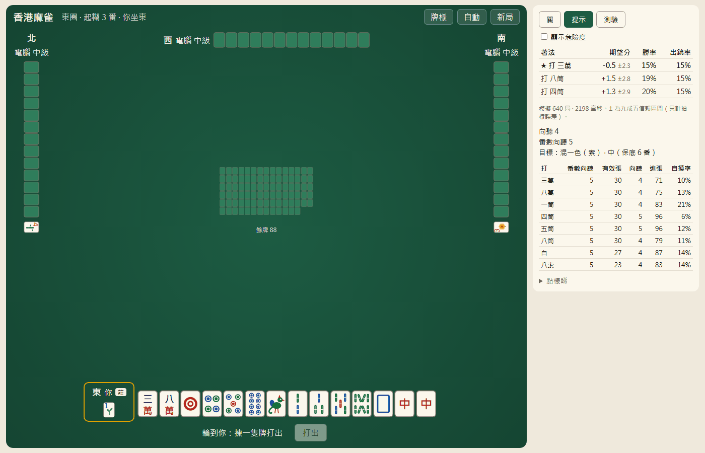

# mahjong — Hong Kong mahjong solver & RL lab

[](https://github.com/bpy13/hk-mahjong-lab/actions/workflows/ci.yml)

A research codebase for studying **Hong Kong mahjong** (香港麻雀) under the rules
in [docs/rules/hk.md](docs/rules/hk.md) (3-faan minimum, 10-faan limit, half-spicy
payout, flowers, 12-tile liability). It pairs a fast Rust rules engine with:

1. **A solver**: exact hand mathematics (shanten and a faan-aware shanten that
   knows a hand must reach 3 faan), a deal-in danger model, and Monte Carlo search
   (PIMC) over hidden tiles sampled to be as developed as real opponents' hands.
2. **A playable web UI** (Traditional Chinese) against bots, with a study mode:
   the top 3 moves with expected points, win and deal-in rates, tile danger, your
   faan-aware progress, a quiz and a post-hand review.
3. **Reinforcement learning**: imitation of the best bot, Deep Monte Carlo
   self-play and PPO with Suphx-style oracle guiding, compared head-to-head with
   the bots and the solver, then combined with search.



## Results

Duplicate tournaments (same walls, seats rotated) against three `value` bots, so 0
means "as good as `value`", the best rule-based bot. Points per hand, "±" is a 95%
interval. Numbers copied from [phase1-solver.md](docs/study-results/phase1-solver.md)
(§1, §4.2) and [phase3-rl.md](docs/study-results/phase3-rl.md) (§2).

| Agent | Points / hand | Win | Deal-in |
|---|---|---|---|
| PIMC solver, 128 samples (pooled over 32–128: +1.7 ± 3.2) | +2.0 ± 5.1 | 22.9% | 17.9% |
| `value` (the reference field) | 0.0 | 23.9% | 17.9% |
| `ppo` (PPO + oracle guiding) | −0.1 ± 2.9 | 13.8% | 22.0% |
| `defensive` | −1.9 ± 1.5 | 18.9% | 14.8% |
| `distill` (imitation of `value`) | −5.6 ± 1.8 | 12.2% | 20.1% |
| `efficiency` (fastest complete hand, ignores faan) | −10.3 ± 1.1 | 2.9% | 22.3% |
| `dmc` (Deep Monte Carlo) | −11.5 ± 1.5 | 1.0% | 24.6% |

Takeaway: corrected PIMC and PPO reach the level of the best heuristic bot (neither is
separated from it at 95%), while playing for speed alone (`efficiency`) loses 10.3
points per hand under the 3-faan minimum. Full write-ups: [docs/study-results/](docs/study-results/).

## Quick start

```sh
conda env create -f environment.yml
conda activate mahjong
make dev     # builds the Rust extension, installs the `mahjong` package and UI deps
make test
```

## Using it

```sh
make serve                                     # web UI on http://127.0.0.1:8000

mahjong hk play --hints                        # play in the terminal, "?" asks the solver
mahjong hk analyze --seed 7 --steps 20         # discard table + solver for one position
mahjong hk tournament value efficiency defensive "pimc:samples=64" --deals 200
mahjong hk patterns                            # the faan table
```

From Python:

```python
from mahjong.hk import Rules, action_chinese
from mahjong._core import analyze

state = Rules().new_deal(seed=1)
for m in analyze(state, samples=400)["moves"][:3]:
    print(action_chinese(m["action"]), f"{m['mean']:+.1f}", f"win {m['win_rate']:.0%}")
```

## Documentation

| Document | What it covers |
|---|---|
| [docs/rules/hk.md](docs/rules/hk.md) | The exact rules implemented, with the faan table and variants |
| [docs/solver.md](docs/solver.md) | Hand mathematics, bots, danger model, PIMC, how far to trust them |
| [docs/ui.md](docs/ui.md) | Web UI, study mode, review, game logs, API |
| [docs/rl.md](docs/rl.md) | Features, networks, distillation, DMC, PPO with oracle guiding |
| [docs/study-results/](docs/study-results/) | Measured results of each experiment |
| [docs/architecture.md](docs/architecture.md) | Code layout, correctness strategy, performance |
| [docs/decisions/](docs/decisions/) | Why the project is built the way it is |
| [CLAUDE.md](CLAUDE.md) | Commands, layout and conventions for contributors |

## Repository layout

```
crates/          Rust: tiles, games (traits), hk (engine), analysis (hand maths),
                 search (bots, danger, PIMC, features, networks), pybind (mahjong._core)
python/mahjong/  Python: hk helpers, cli, server (FastAPI), rl (PyTorch)
web/             React + TypeScript UI (Vite); browser tests in web/tests
experiments/     Scripts that produce the results in docs/study-results/
docs/            Rules spec, solver and RL notes, architecture, decisions, results
```
