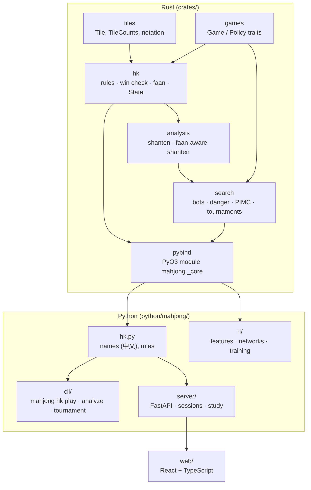

# Architecture

## Layers

**`crates/tiles`**: the 34 playing kinds and 8 bonus tiles, text notation
(`123m 55p EEE WhWh F2`), Unicode glyphs, and `TileCounts` (a hand as `[u8; 34]`,
with per-suit base-5 keys for lookup tables).

**`crates/games`**: the `Game` and `Policy` traits. Mahjong's simultaneous claims
are sequenced (one seat at a time) but hidden: a seat's declaration never appears
in another seat's observation, and `determinize` forgets other seats' pending
declarations ([ADR 0001](decisions/0001-standalone-repo-claim-aware-engine.md)).

**`crates/hk`**: the engine. `hand` checks complete hands with a precomputed
per-suit table (built once from meld combinations) and lists every split for
scoring; `faan` implements the table row by row; `state` is the hand as a state
machine with an event log. Actions have stable integer codes (0–133) used by
Python and as the RL action space.

A state starts either from a full wall (`State::from_wall`, a new deal) or from a
mid-hand position (`State::from_position(rules, &PositionSpec)`, in `position.rs`):
hands, melds, bonus tiles, the river with claimed flags, the wall count, the seat
to move, the phase (`Turn`, `Claim { tile, from }`, `Rob { tile, from }`), the last
drawn tile, the kong chain and liability. It fills the undrawn wall with the
leftover tiles in index order (invisible to observers, since samplers sort the
hidden pool), writes one `Discard` event per river entry (and a `Claim` after each
claimed one) so danger and features see the discard history, and asks every seat
with an option again in a claim or rob window. A malformed position (a fifth copy,
a wrong hand size, claims that do not pair with exposed melds, an unbalanced wall,
a claim tile that is not the last discard) returns a `PositionError`, never a
panic. `State::to_position` gives the reverse. `tests/from_position.rs` checks 200
positions from seeded hands: legal actions, scores, danger, features and the PIMC
shortlist match the original. Python: `HkState.from_position(...)`.

**`crates/analysis`** and **`crates/search`**: see [solver.md](solver.md).

Three pieces from the self-play plan (2026-11-16, [ADR 0003](decisions/0003-self-play-network.md)):

* **The three-stage bot `stage`** (`crates/search/src/stage.rs`, lines of play in
  `route.rs`; bot names in `bots.rs`; tools `examples/compare.rs`, `dealin.rs`,
  `stage_speed.rs`, `fit_routes.rs`): a rule bot with no tables that leads with
  the closest of half flush, all pungs, thirteen orphans and all chows, and plays
  stage 1 (throw tiles outside the line), stage 2 (every tile fits: distance, faan,
  helping tiles) or stage 3 (ready or one from ready: winning tiles times points).
  Since Task 9 `stage` is the strict form (stage 3 only when no tile lies outside
  the leading line); `stage-gate0` is the earlier form, `stage-gate2` keeps a ready
  hand in stage 3. It is the baseline of the self-play run: +2.62 ± 0.21 per hand
  against three `value` bots over 40,000 deals (`docs/study-results/stage3-gate.md`,
  `three-stage-bot.md`).
* **The `history` network input** (`features::encode_history`, 3,460 floats; Python
  reference `mahjong.rl.cnn.encode_history`): every discard of every seat in order,
  each marked drawn-and-thrown or from the hand and claimed or not. A separate input
  version named in the model file, so every earlier network loads unchanged
  ([rl.md §2](rl.md)).
* **The opponent pool** (`python/mahjong/rl/pool.py`, `ppo_cnn --pool`, job scripts
  in `experiments/stage/`): in self-play each of the learner's three opponents is
  drawn per hand (current network 50 %, a saved older network 30 %, `stage` 20 %),
  with the stop rules and the kept best network ([rl.md §4](rl.md)).

**`crates/pybind`**: everything above as plain Python values (tiles and actions
are `int`, results are dicts). `python/mahjong/_core.pyi` documents and types it.

## Correctness strategy

| Layer | Check |
|---|---|
| Win check | Table lookup vs recursive splitting on random hands |
| Faan table | A test for every example in the spec (`crates/hk/tests/faan_spec.rs`) |
| Turn flow, claims, kongs, payment, liability | Scenario tests built from exact walls, one per rule (`scenarios.rs`) |
| Invariants | Random hands under random rule variants: tiles conserved, zero-sum, termination, last-discard rule, determinization keeps the observer's view (`properties.rs`) |
| Whole engine | Differential test against an independent pure-Python implementation (`python/tests/reference/`): same legal actions at every step of 3,000 random and 1,500 clumped-wall hands; same score on 20,000 constructed hands covering every hand-based pattern |
| Shanten | Agrees with the engine's win check on 60,000 random hands |
| Solver, bots, features | Identical decisions (and identical network inputs) for positions that differ only in hidden tiles |
| Server | A move submitted while hints are computing succeeds (regression test) |
| UI | Unit tests (Vitest) and a browser test that plays a full hand with hints and review (Playwright) |

## Performance (Apple M1)

| Operation | Speed |
|---|---|
| Random playout of a hand | ~50 µs |
| Shanten | ~0.3 µs |
| Faan-aware shanten | ~6 µs |
| `fast` bot, a whole hand for all four seats | ~1.7 ms |
| `value` bot, a whole hand | ~40 ms |
| PIMC, 32 samples × 4 candidates, 8 threads | ~0.2 s |
| Feature encoding (one decision) | ~80 µs |
| Network forward pass (831 → 512 → 512 → 256 → 134, Rust) | ~160 µs |
| A hand played by the network in all four seats | ~18 ms |
