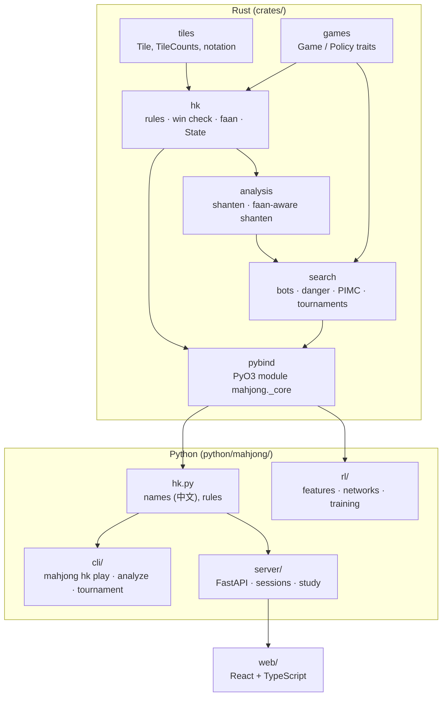

# Architecture

## Layers

**`crates/tiles`**: the 34 playing kinds and 8 bonus tiles, text notation
(`123m 55p EEE WhWh F2`), Unicode glyphs, and `TileCounts` (a hand as `[u8; 34]`,
with per-suit base-5 keys for lookup tables).

**`crates/games`**: the `Game` and `Policy` traits. Mahjong's simultaneous claims
are sequenced (one seat at a time) but hidden: a seat's declaration never appears
in another seat's observation, and `determinize` forgets other seats' pending
declarations ([ADR 0001](decisions/0001-standalone-repo-claim-aware-engine.md)).

**`crates/hk`**: the engine. `hand` checks complete hands with a precomputed
per-suit table (built once from meld combinations) and lists every split for
scoring; `faan` implements the table row by row; `state` is the hand as a state
machine with an event log. Actions have stable integer codes (0–133) used by
Python and as the RL action space.

**`crates/analysis`** and **`crates/search`**: see [solver.md](solver.md).

**`crates/pybind`**: everything above as plain Python values (tiles and actions
are `int`, results are dicts). `python/mahjong/_core.pyi` documents and types it.

## Correctness strategy

| Layer | Check |
|---|---|
| Win check | Table lookup vs recursive splitting on random hands |
| Faan table | A test for every example in the spec (`crates/hk/tests/faan_spec.rs`) |
| Turn flow, claims, kongs, payment, liability | Scenario tests built from exact walls, one per rule (`scenarios.rs`) |
| Invariants | Random hands under random rule variants: tiles conserved, zero-sum, termination, last-discard rule, determinization keeps the observer's view (`properties.rs`) |
| Whole engine | Differential test against an independent pure-Python implementation (`python/tests/reference/`): same legal actions at every step of 3,000 random and 1,500 clumped-wall hands; same score on 20,000 constructed hands covering every hand-based pattern |
| Shanten | Agrees with the engine's win check on 60,000 random hands |
| Solver, bots, features | Identical decisions (and identical network inputs) for positions that differ only in hidden tiles |
| Server | A move submitted while hints are computing succeeds (regression test) |
| UI | Unit tests (Vitest) and a browser test that plays a full hand with hints and review (Playwright) |

## Performance (Apple M1)

| Operation | Speed |
|---|---|
| Random playout of a hand | ~50 µs |
| Shanten | ~0.3 µs |
| Faan-aware shanten | ~6 µs |
| `fast` bot, a whole hand for all four seats | ~1.7 ms |
| `value` bot, a whole hand | ~40 ms |
| PIMC, 32 samples × 4 candidates, 8 threads | ~0.2 s |
| Feature encoding (one decision) | ~80 µs |
| Network forward pass (831 → 512 → 512 → 256 → 134, Rust) | ~160 µs |
| A hand played by the network in all four seats | ~18 ms |
